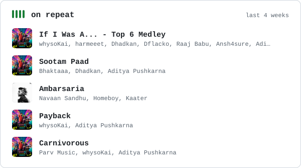

<picture>
  <source media="(prefers-color-scheme: dark)" srcset="assets/header-dark.svg">
  
</picture>

I'm a developer who loves problem solving. I work as an engineer at [Fam](https://www.famapp.in/), and before that I was at [Dyte](https://dyte.io) (**now Cloudflare**). I write about what I learn at [blogs.sakshamgt.com](https://blogs.sakshamgt.com).

Away from the keyboard I train in martial arts, usually with Punjabi music on.

### Latest writing

<!-- blog:start -->
- [Building a Sentiment Analysis Workflow with LangChain](https://blogs.sakshamgt.com/posts/langchain-intro/) May 2026
- [Creating Vector Embeddings for Textual Data Using BERT From Scratch](https://blogs.sakshamgt.com/posts/creating-vector-embeddings-with-bert/) May 2026
- [Sero Listens — Social Listening Tool](https://blogs.sakshamgt.com/posts/sero-listens-social-listening-tool/) Apr 2026
<!-- blog:end -->

More at [blogs.sakshamgt.com](https://blogs.sakshamgt.com).

### Open source

  <a href="https://github.com/CollActionteam/collaction_app/pulls?q=is%3Apr+author%3Asaksham-gt+is%3Amerged"><picture><source media="(prefers-color-scheme: dark)" srcset="assets/oss-collaction-dark.svg"></picture></a>
  <a href="https://github.com/PalisadoesFoundation/talawa/pulls?q=is%3Apr+author%3Asaksham-gt+is%3Amerged"><picture><source media="(prefers-color-scheme: dark)" srcset="assets/oss-talawa-dark.svg"></picture></a>
  <a href="https://github.com/tensorflow/flutter-tflite/pulls?q=is%3Apr+author%3Asaksham-gt+is%3Amerged"><picture><source media="(prefers-color-scheme: dark)" srcset="assets/oss-flutter-tflite-dark.svg"></picture></a>

### Things I've made

- [`youtube-transcript-automation`](https://github.com/saksham-gt/youtube-transcript-automation): pull a transcript out of any YouTube video with one Whisper-powered command.
- [`design-patterns-in-flutter`](https://github.com/saksham-gt/design-patterns-in-flutter): the Gang of Four patterns, worked through in Dart.
- [`chat_messaging_via_websockets`](https://github.com/saksham-gt/chat_messaging_via_websockets): real-time chat in Flutter over WebSockets.
- [`learning-go-by-example`](https://github.com/saksham-gt/learning-go-by-example): my notes and exercises from picking up Go.
- [`my-nvim`](https://github.com/saksham-gt/my-nvim): the Neovim config I work in every day.
- [`tils`](https://github.com/saksham-gt/tils): small things I learn, written down as I go.

### Toolbox

`Dart` `Flutter` `Kotlin` `Kotlin Multiplatform` `Go` `Java` `Lua` `Neovim`

### On repeat

<!-- spotify:start -->
<a href="https://open.spotify.com/track/21Kjwtw7Nv25WtRJRcccKe"><picture>
  <source media="(prefers-color-scheme: dark)" srcset="assets/on-repeat-dark.svg">
  
</picture></a>
<!-- spotify:end -->

### Say hi

[Blog](https://blogs.sakshamgt.com) · [Twitter](https://twitter.com/sakshamgt) · [LinkedIn](https://www.linkedin.com/in/saksham-gt/) · Ask me which book I'm reading.

He/him · Bangalore, India
